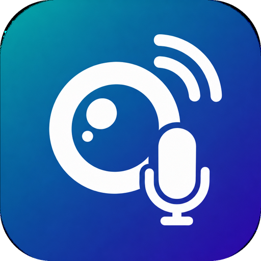

<div align="center">



# TelePresence

**Use a camera and microphone on one computer as a webcam on another, over the local network.**

[](LICENSE)
[](#requirements)

</div>

---

One machine runs as the **Sender**: it captures a camera and microphone,
encodes H.264 and Opus, and streams them over QUIC. Another runs as the
**Receiver**: it decodes the stream and presents it as the "TelePresence
Camera", which Zoom, Teams, OBS, a browser or any other app can pick like a
physical webcam.

Traffic never leaves the LAN. Peers find each other over mDNS, pair once with
a six-digit code, and pin each other's certificate from then on.

## Requirements

| Role | Windows 11 | macOS | Linux |
| --- | --- | --- | --- |
| Sender | yes | yes | yes |
| Receiver, preview and audio playback | yes | yes | yes |
| Receiver, virtual camera | yes | not yet | not yet |
| Receiver, virtual microphone | via [VB-Cable](https://vb-audio.com/Cable/) | not yet | not yet |

- Windows: Windows 11 (build 22000 or later). The virtual camera is built on
  `MFCreateVirtualCamera`, which Windows 10 does not have.
- macOS: universal build for Apple Silicon and Intel. The camera extension
  and audio plug-in are planned.
- Linux: x86_64, GStreamer 1.24 or later (Ubuntu 24.04 or newer).
- Both machines on the same network. Only loopback, RFC 1918, link-local and
  IPv6 ULA addresses are accepted.
- UDP port 47800 reachable on the Receiver, and mDNS (UDP 5353) for discovery.

## Install

Installers are published on the
[releases page](https://github.com/Locke-Werks/telepresence/releases):

| Platform | Asset |
| --- | --- |
| Windows | `telepresence-<version>-windows-x64-setup.exe` |
| macOS | `telepresence-<version>-macos-universal.dmg` |
| Linux | `telepresence_<version>_amd64.deb`, `telepresence-<version>-linux-x86_64.AppImage` |

The Windows installer needs administrator rights: it installs to Program
Files and registers the virtual camera with Windows Frame Server.

For received audio to appear as a microphone on Windows, install VB-Cable
separately. The Receiver plays into "CABLE Input", and apps then select
"CABLE Output" as their microphone. Without it, video works and audio plays
nowhere (or on the default output if you choose that).

## Usage

### Desktop app

Run TelePresence with no arguments to open the window.

1. On the Receiver machine, choose **Receiver** and start it. It shows a
   pairing code.
2. On the Sender machine, choose **Sender**, pick the Receiver from
   "Receivers on this network" (or type its address), pick a camera and
   microphone, enter the pairing code and start.
3. In your video app on the Receiver, select **TelePresence Camera**.

The code is only needed the first time. After that both sides remember each
other and reconnect without it. "Forget" under "Paired senders" revokes one.

### Command line

The same binary is a CLI:

```
telepresence devices
telepresence receive [--port 47800] [--name NAME] [--audio-out auto|default|none|<device>] [--no-advertise]
telepresence send [--peer ip[:port]|name] [--code 123456] [--camera ID] [--mic ID]
                  [--size WxH|native] [--fps N|native] [--bitrate KBPS|auto]
                  [--test-source] [--name NAME]
```

- `devices` lists cameras, microphones and audio outputs with the ids `send`
  accepts.
- `send` with no `--peer` connects to the first Receiver it discovers.
- `--camera`, `--mic`, `--size`, `--fps` and `--bitrate` are saved and reused
  on later runs.
- `--mic default` is refused on purpose: the system default input moves to
  AirPods or a headset the moment one connects.
- `--test-source` sends a test pattern and tone instead of real devices.
- `--config-dir DIR` (any subcommand) uses a separate identity and pin store.
  `TELEPRESENCE_CONFIG_DIR` does the same.
- `RUST_LOG=debug` raises log verbosity.

### Video quality

By default the Sender uses the camera's native mode (preferring NV12, then
packed YUV, then MJPEG), capped at 60 fps. Encoding uses the first hardware
H.264 encoder available (NVENC, Quick Sync, Media Foundation, VideoToolbox,
VA-API) and falls back to x264. Bitrate adapts to loss reported by the
Receiver: it drops 20% when loss exceeds 2% and climbs 5% after three clean
seconds, never above the `--bitrate` ceiling.

## Updates

The app checks GitHub Releases at most once a day (configurable in the
window) and offers newer stable versions. Each download is verified against
the release's `SHA256SUMS` before it is installed. Prereleases are never
offered.

## Configuration and data

| Platform | Location |
| --- | --- |
| Windows | `%APPDATA%\TelePresence` |
| macOS | `~/Library/Application Support/TelePresence` |
| Linux | `$XDG_CONFIG_HOME/TelePresence` (usually `~/.config/TelePresence`) |

The Sender and Receiver roles keep separate identities (`identity.pem`) and
pin lists in `sender/` and `receiver/`, so pairing in one role grants nothing
in the other. Deleting a role's directory resets its identity and forgets
every pairing.

## Documentation

- [Architecture](docs/architecture.md): crates, drivers, and how media moves.
- [Wire protocol](docs/protocol.md): QUIC transport, pairing, datagram format.
- [Shared-memory sink format](docs/sink-format.md): the contract between the
  Receiver and the virtual device drivers.
- [Building](docs/building.md): toolchains and local builds per platform.
- [Releasing](docs/releasing.md): the tag-driven release pipeline and signing.

## License

GPL-3.0-only. See [LICENSE](LICENSE). Release builds bundle Qt 6 (LGPLv3) and
GStreamer (LGPLv2.1 or later, some plugins under other licenses); their
license texts ship with the installers.
